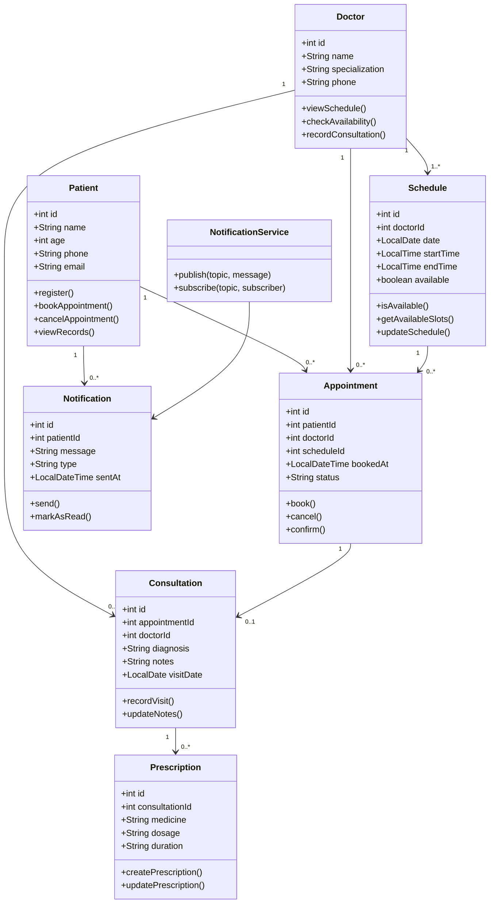
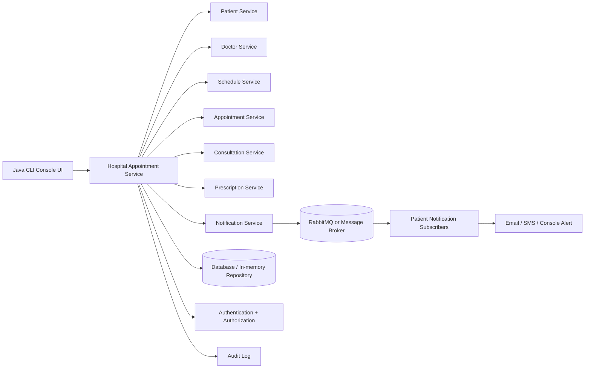

# Hospital Appointment and Patient Management System

## 1. Project Overview
This project is a simple Java Command Line Interface (CLI) application for a hospital appointment and patient management system. It is designed to support the core hospital workflow such as patient registration, doctor management, schedule checking, appointment booking, cancellation, consultation recording, prescription generation, and notifications.

This project is built to match the assignment requirement for:
- LLD (Low-Level Design): UML class diagram + responsibilities + methods
- HLD (High-Level Design): system architecture with services, database, and messaging
- Experiment: publish/subscribe notification service using RabbitMQ concepts

---

## 2. Use Case Summary
A healthcare provider manages patient registration, doctor schedules, appointments, records, prescriptions, and notifications. Patients can book or cancel appointments, while staff can view doctor availability and manage appointment records. The system should avoid double-booking, protect medical records, and notify patients about important booking or cancellation events.

---

## 3. Functional Requirements Covered
- Register and manage patients
- Manage doctors and their specialization
- View doctor schedules and slots
- Book and cancel appointments
- Prevent double-booking
- Record consultation outcome and prescription details
- Send notification messages for booking and cancellation events
- Simulate a publish/subscribe notification pattern using Java

---

## 4. LLD (Low-Level Design)
The low-level design defines system classes, attributes, behaviours, and relationships between entities.

### 4.1 UML Class Diagram


### 4.2 Class Responsibilities
- Patient: manages personal data and appointment actions.
- Doctor: views schedule, checks availability, and records consultation outcomes.
- Schedule: stores doctor working slots and availability.
- Appointment: represents booking, confirmation, and cancellation.
- Consultation: stores diagnosis, notes, and visit date.
- Prescription: stores medicine name, dosage, and duration.
- Notification: sends reminder, booking, or cancellation notifications.

### 4.3 Design Decisions
- Double-booking prevention: a booked schedule slot is marked unavailable.
- Cancellation handling: appointment status is updated instead of deleting the record.
- Data confidentiality: patient and prescription data are restricted to authorized users.
- Notification mechanism: booking/cancel notifications use the publish/subscribe model.

---

## 5. HLD (High-Level Design)
The high-level design shows the major components of the hospital management system and how they communicate.

### 5.1 Architecture Diagram


### 5.2 HLD Explanation
- Client Layer: Java CLI interacts with the system.
- Application Layer: handles patient, doctor, appointment, consultation, and notification logic.
- Data Layer: stores patient, doctor, schedule, appointment, and prescription records.
- Messaging Layer: RabbitMQ is used for publish/subscribe notification events.
- Security Layer: authentication and authorization protect medical information.
- Reliability Layer: logging and audit trail help with accountability and troubleshooting.

### 5.3 Why This Architecture is Good
- Scalable: each service can evolve independently.
- Maintainable: responsibilities are separated.
- Secure: patient records are isolated behind access controls.
- Fault-tolerant: message-based notification avoids blocking the main workflow.

---

## 6. RabbitMQ Publish/Subscribe Experiment
### Aim
To implement a simple publish/subscribe notification service for the hospital application so that appointment booking and cancellation notifications are delivered to interested subscribers.

### Algorithm
1. Start the Java program.
2. Create patient and doctor objects.
3. Check doctor availability and book an appointment.
4. Publish a notification event with patient topic.
5. Subscribers receive the message.
6. Cancel the appointment and publish a cancellation event.
7. Display the result.

### Program Logic
This project demonstrates the design using a Java notification service with a publish/subscribe pattern. In a real RabbitMQ setup, the same pattern would be implemented with queue/exchange-based messaging.

### Sample Output
```text
Hospital CLI
1. List patients
2. List doctors
3. List schedules
4. Book appointment
5. Cancel appointment
6. List appointments
0. Exit
Choose: 4
Enter patient id: 1
Enter schedule id: 1
Booked: 1: patient#1 dr#1 sched#1 status:BOOKED @2026-10-13T...
[Notification publish] topic=patient:1 msg=Your appointment 1 is booked for 2026-10-14 09:00
[To Patient 1] Your appointment 1 is booked for 2026-10-14 09:00
```

### Result
The system demonstrates appointment booking, scheduling logic, and publish/subscribe-style notification processing successfully in Java CLI form.

---

## 7. Project Structure
```text
HospitalManagementSystem/
├── README.md
├── .gitignore
├── src/
│   ├── Main.java
│   ├── Patient.java
│   ├── Doctor.java
│   ├── Schedule.java
│   ├── Appointment.java
│   ├── NotificationService.java
│   ├── Repository.java
│   └── ...
└── data/
```

---

## 8. How to Run
Open terminal in the project folder and run:

```bash
cd HospitalManagementSystem
cd src
javac *.java
java Main
```

You will see a menu where you can:
- List patients
- List doctors
- List schedules
- Book appointment
- Cancel appointment
- Show appointment records

---

## 9. GitHub Repository
This project is designed for upload to GitHub and can be pushed to a repository as a Java CLI hospital management system project.

---

## 10. Conclusion
This project successfully covers the hospital appointment and patient management use case with object-oriented design, low-level design, high-level design, and a simple notification mechanism. It is suitable for assignment submission and can be extended with real RabbitMQ integration, database persistence, and a full GUI in future versions.

